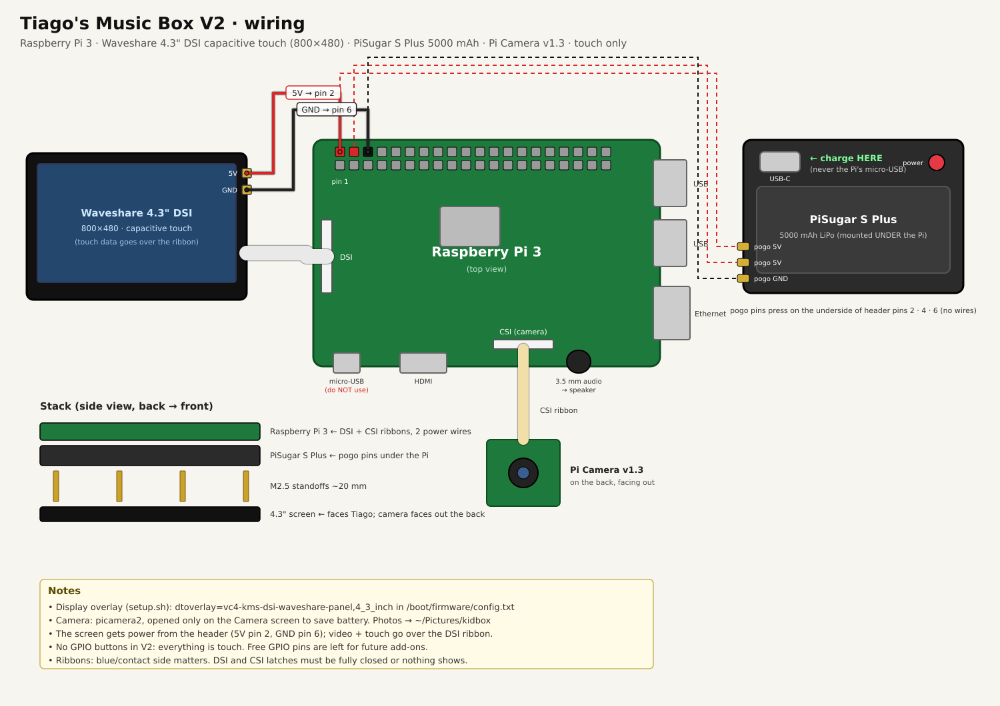
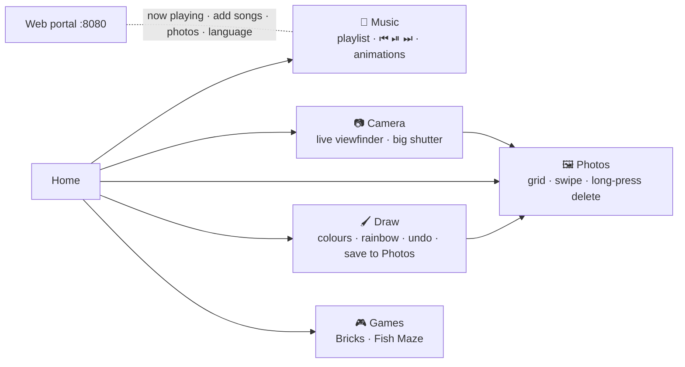

# 🎵 Tiago's Music Box V2 (handheld, touch)

Pi 3 + Waveshare 4.3" DSI capacitive touch (800×480) + PiSugar S Plus 5000 mAh + Pi camera. Touch only. V1 (button + OLED) lives in [music-button-pi](https://github.com/fgomecs/music-button-pi) and is separate.



_Details: see [Wiring](#wiring)._



## Wiring

_Diagram source: `docs/src/gen_v2.py` (regenerate: `cd docs/src && python3 gen_v2.py ../wiring-v2.svg && rsvg-convert -w 1500 ../wiring-v2.svg -o ../wiring-v2.png`)._

## Hardware stack (back to front)
```
 [ Pi 3 ]          ← DSI ribbon + 2 power wires to the screen, camera ribbon on CSI
 [ PiSugar S Plus ]← battery, pogo pins under the Pi (charge HERE, never the Pi's port)
 ║  ║  ║  ║       ← M2.5 standoffs (~20 mm)
 [ 4.3" screen ]   ← faces the kid; camera on the back faces out
```

## Setup
```bash
git clone git@github.com:fgomecs/tiagos-music-box-v2.git ~/kidbox
cd ~/kidbox && bash v2/setup.sh && sudo reboot
```
Installs packages, enables the 4.3" DSI overlay, starts the kids app at boot, installs the portal (http://<pi-ip>:8080).

## Adding songs & stories
Portal → *Add songs & stories* → paste `URL Name` rows → *Check size & space* → *Download & add*. Or SSH: `python3 add_songs.py`. Songs (`song*.mp3`) and photos are not stored in git.

## Files
| File | Purpose |
|---|---|
| `v2/kidbox.py` | Kids app (music, camera, photos, draw, games menu), 800×480 touch |
| `v2/games.py` | Draw pad, Bricks (drag paddle, tap to launch), Fish Maze (swipe or tap to steer) |
| `v2/setup.sh` | One-time setup |
| `portal.py` | Web portal: now playing + live screen mirror, add songs, photos, language |
| `add_songs.py` | Song download engine (yt-dlp + deno), library/capacity report |
| `musicstate.py` | Shared state between app and portal (/dev/shm) |
| `config.py` | V2 song list (SONGS + SONG_NAMES, same order) |
| `song_sources.json` | YouTube URL per song file |

<!-- SONGS:START -->
| # | File | Name | Source |
|---|---|---|---|
<!-- SONGS:END -->

## Notes
- Video is locked: audio-only (`v2/settings.json` → `video_unlocked`).
- Photos: `~/Pictures/kidbox`. Download/delete from the portal.
- Test on a PC: `KIDBOX_WINDOW=1 python3 v2/kidbox.py`
