# 🎵 Tiago's Music Box V2 (handheld, touch)

Pi 3 + Waveshare 4.3" DSI capacitive touch (800×480) + PiSugar S Plus 5000 mAh + Pi camera. Touch only, no desktop: the Pi boots straight into the kids app. V1 (button + OLED) lives in [music-button-pi](https://github.com/fgomecs/music-button-pi) and is separate.

**What Tiago gets:** music & stories with an animated sea (fish, turtle, jellyfish, octopus, crab, whale), a camera + photo gallery, finger painting, and 4 games (Bricks, Fish Maze, Mole Dig, and the real 1983 **Digger**). Parents manage everything from the web portal.


_Details: see [Wiring](#wiring)._

## Screenshots

_Rendered from the real code (`v2/kidbox.py`, `v2/games.py`, `portal.py`) at the panel's 800×480. The camera/photo images are drawn samples, not real photos. Scripts: `docs/src/kidbox_shots.py`, `docs/src/shoot.py`._

### Touch screen

| Home | Music (playing) | Home + now playing |
|---|---|---|
| 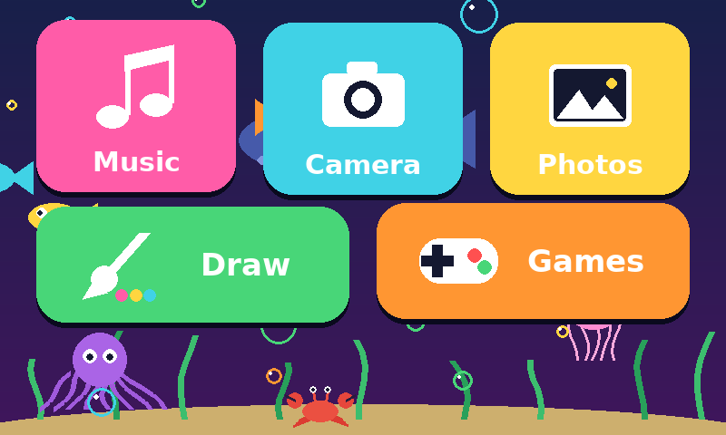 | 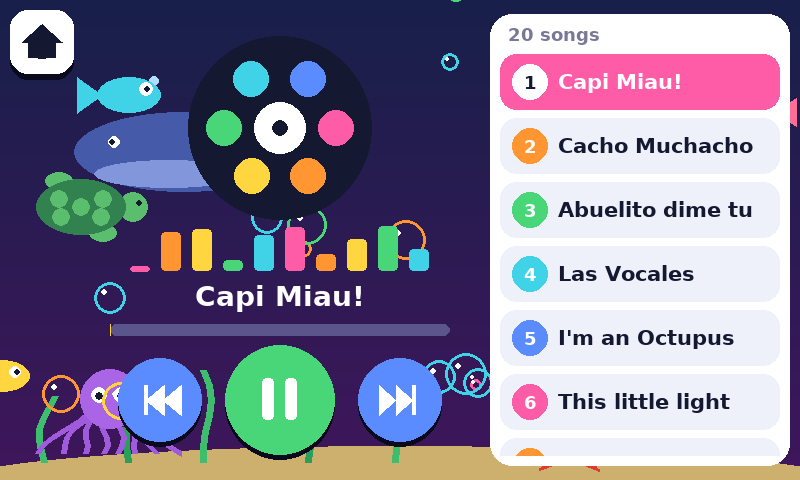 | 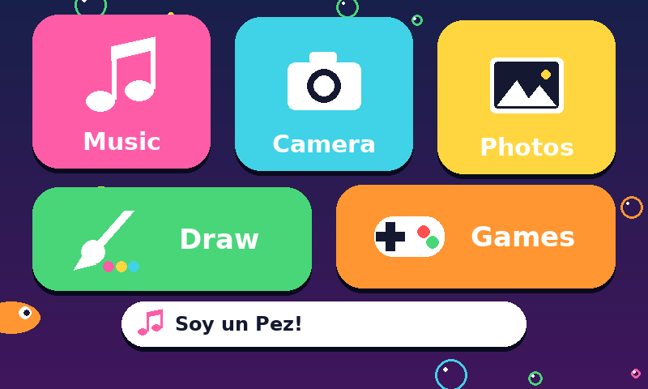 |
| **Camera** | **Photos** | **Photo viewer** |
| 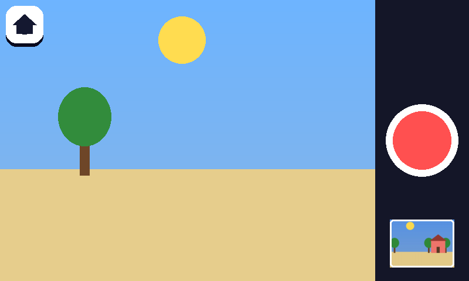 | 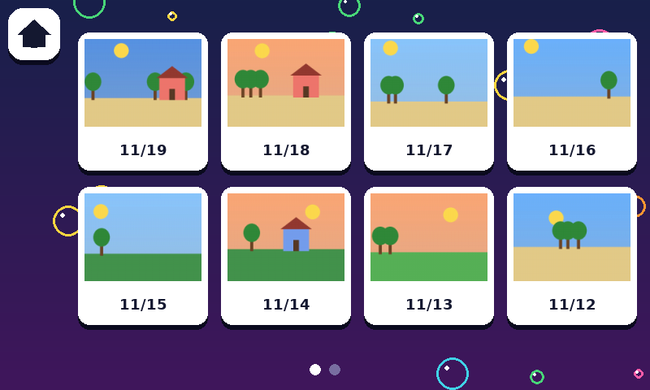 | 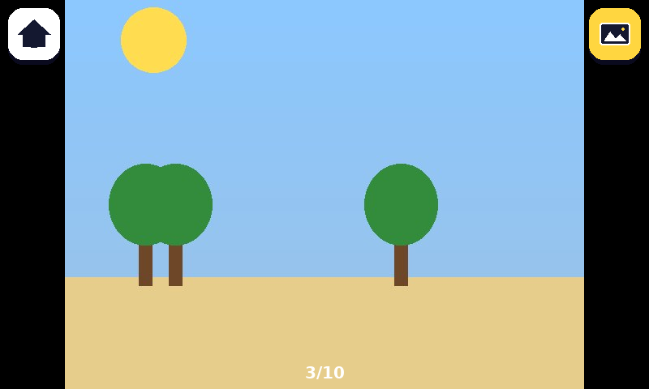 |
| **Draw** | **Games** | **Bricks** |
| 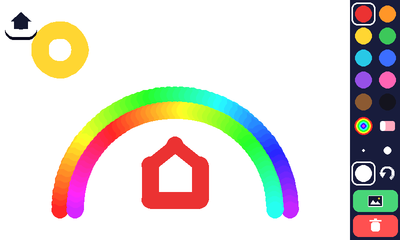 | 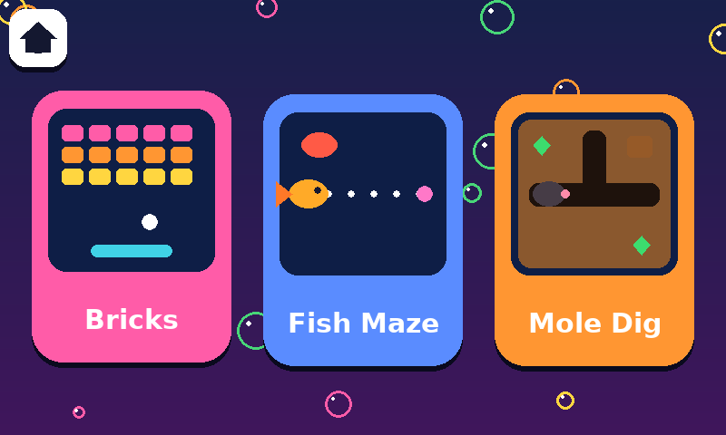 | 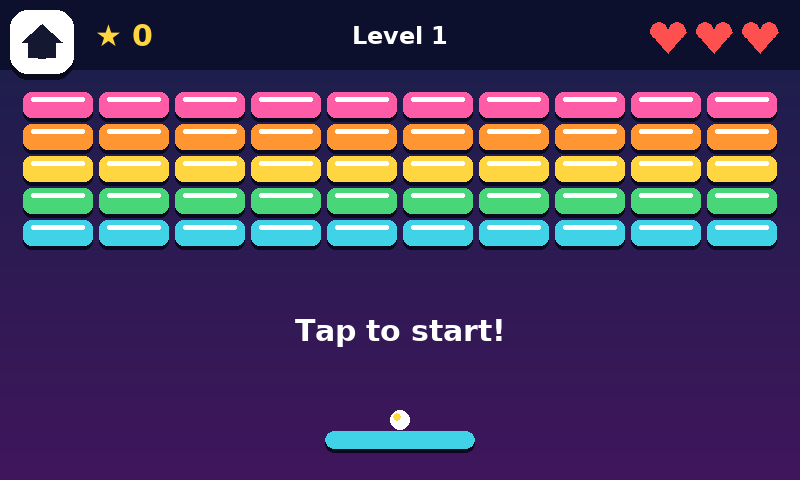 |
| **Fish Maze** | **Mole Dig** | **Parent menu** (hold top-left 5 s) |
| 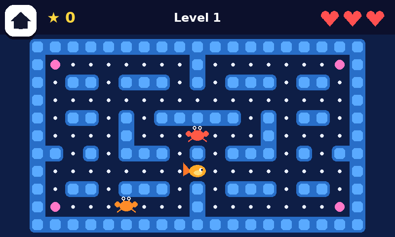 | 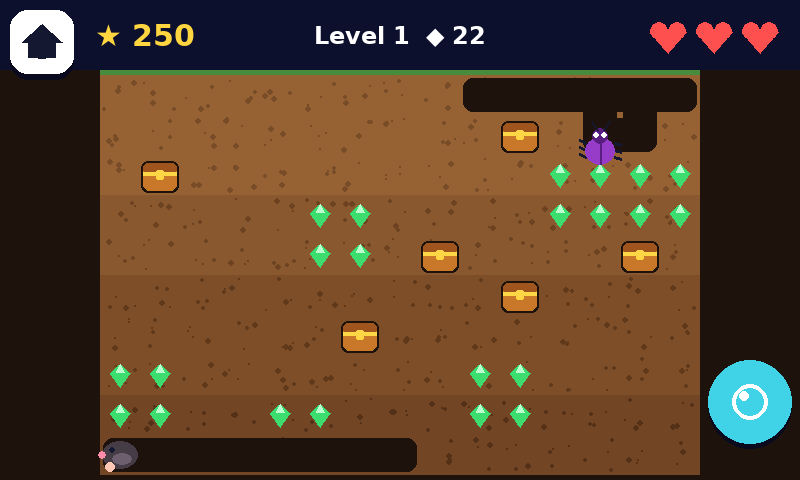 | 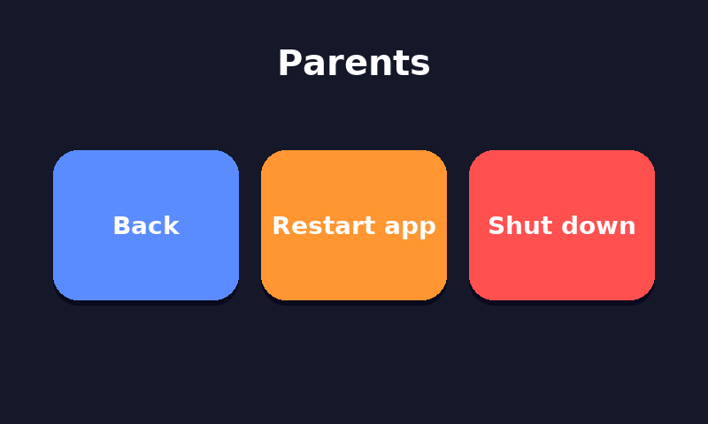 |

### Web portal (http://&lt;pi-ip&gt;:8080)

| Desktop | Phone |
|---|---|
| 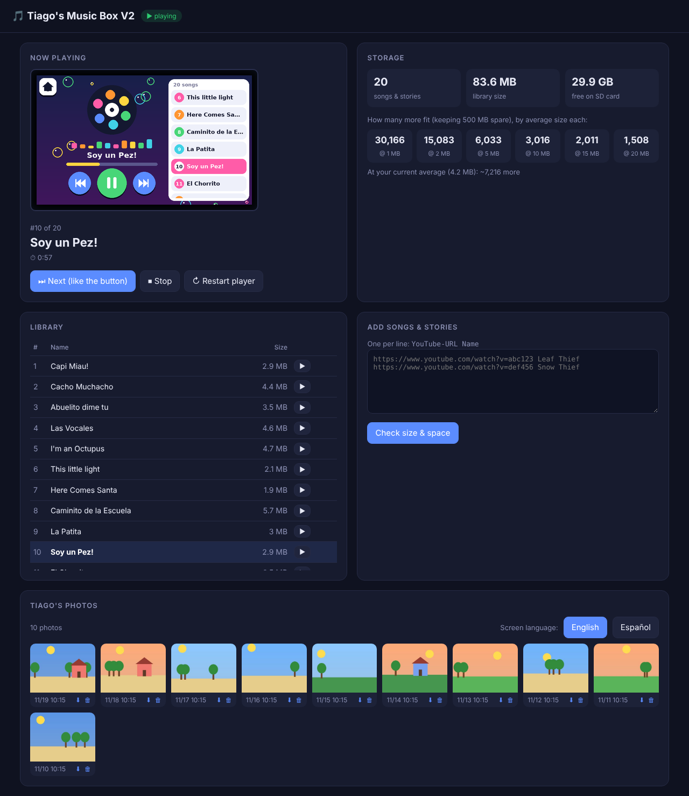 | 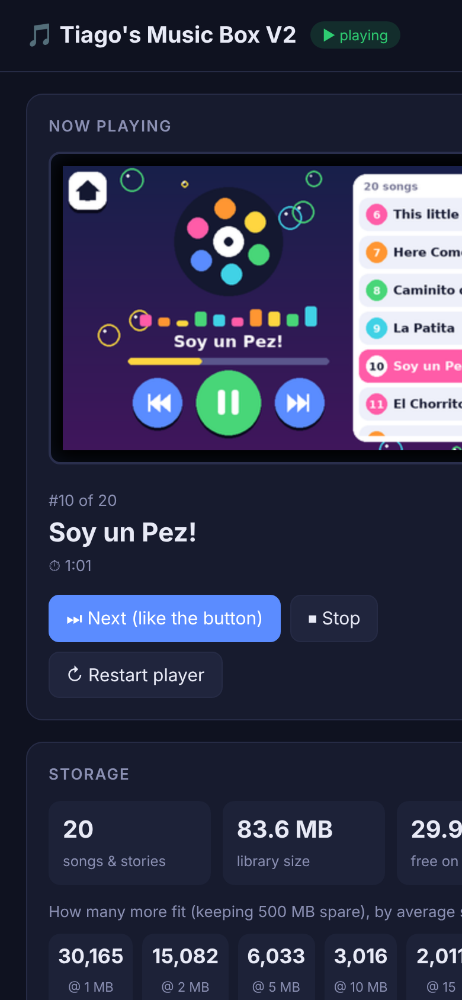 |

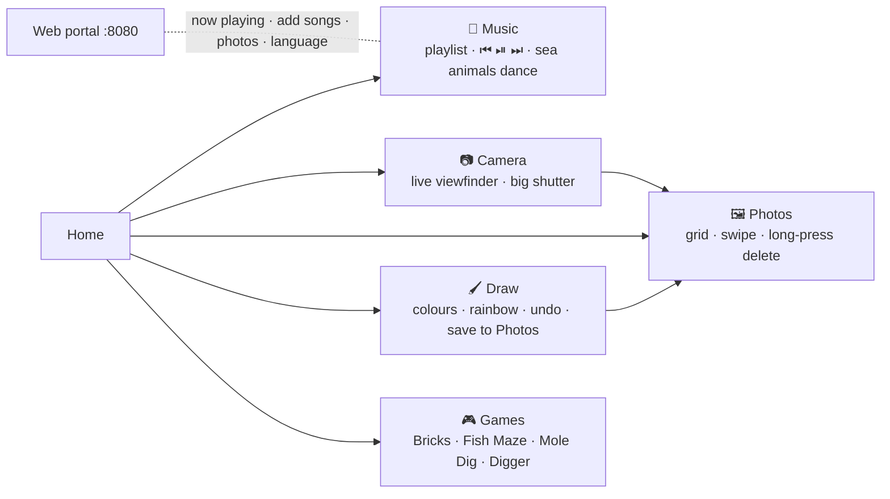

## Wiring

_Diagram source: `docs/src/gen_v2.py` (regenerate: `cd docs/src && python3 gen_v2.py ../wiring-v2.svg && rsvg-convert -w 1500 ../wiring-v2.svg -o ../wiring-v2.png`)._

## Hardware stack (back to front)
```
 [ PiSugar S Plus ]← battery at the back; its pogo pins touch the underside of the Pi's GPIO header
 [ Pi 3 ]          ← components face the screen; DSI ribbon to the screen (also powers it), camera on CSI
 ║  ║  ║  ║       ← brass standoffs (~25 mm), room for an amp on the GPIO pins
 [ 4.3" screen ]   ← faces the kid; camera faces out the back
```
- **Charge** through the PiSugar's USB-C, never the Pi's micro-USB. **Turn off:** parent menu → *Shut down*, wait for the green light to stop, then the PiSugar switch.
- **Sound:** played straight to the sound card (no desktop audio layer). Planned: Adafruit I2S Speaker Bonnet (MAX98357A) + 3 W speaker on the GPIO pins, so it works without headphones.
- **Case:** custom 3D print planned once the speaker is in.

## Setup
```bash
git clone git@github.com:fgomecs/tiagos-music-box-v2.git ~/kidbox
cd ~/kidbox && bash v2/setup.sh && sudo reboot
```
Installs packages, enables the 4.3" DSI overlay, makes the Pi boot straight into the kids app (no desktop), installs the portal (http://<pi-ip>:8080).

Optional, the real Digger (builds in ~5–10 min): `bash v2/install_digger.sh && sudo systemctl restart kidbox`

Update later: `cd ~/kidbox && git pull --no-edit && sudo systemctl restart kidbox`

### No-desktop (appliance) mode
`v2/appliance.sh on` (default from setup) runs the app as a boot service (`kidbox.service`) on the bare screen: faster boot, more memory for games, restarts itself if it crashes. Pi Connect's remote shell, SSH and the portal keep working; Pi Connect screen sharing doesn't (no desktop).
- **Parent menu:** hold the top-left corner 5 s → *Back*, *Restart app*, *Shut down*.
- **Back to the desktop:** `bash ~/kidbox/v2/appliance.sh off && sudo reboot`
- **Log:** `tail -30 ~/kidbox/v2/kidbox.log`

## Games
| Game | How to play |
|---|---|
| **Bricks** | Slide a finger in the strip under the paddle; tap to launch the ball |
| **Fish Maze** | Swipe, or tap the side you want to go; eat pearls, pink pearl = crabs turn blue |
| **Mole Dig** | Swipe/tap a direction and the mole keeps digging (tap the mole to stop). Collect gems, drop chests on beetles, round button = bubble that finds the nearest beetle by itself |
| **Digger** | The real 1983 game ([Digger Remastered](https://digger.org), SDL port [sobomax/digger](https://github.com/sobomax/digger)). Swipe = steer (keeps going), tap = fire / start, hold any corner 3 s = back to the menu. High scores are saved as "TIA" (no keyboard needed) |

Camera and games pause the music (one thing at a time on a Pi 3); Play resumes where it stopped.

## Adding songs & stories
Portal → *Add songs & stories* → paste `URL Name` rows → *Check size & space* → *Download & add*. Or SSH: `python3 add_songs.py`. Songs (`song*.mp3`) and photos are not stored in git.

## Files
| File | Purpose |
|---|---|
| `v2/kidbox.py` | Kids app (music, camera, photos, draw, games menu, sea animation, parent menu), 800×480 touch |
| `v2/games.py` | Draw pad, Bricks, Fish Maze, Mole Dig, game sounds |
| `v2/setup.sh` | One-time setup |
| `v2/appliance.sh` | `on`: boot straight into the app (no desktop) · `off`: back to the desktop |
| `v2/install_digger.sh` | Builds the real Digger into `v2/bin/` |
| `v2/digger_touch.py` | Touchscreen → keys for Digger (swipe/tap/corner hold) |
| `portal.py` | Web portal: now playing + live screen mirror, add songs, photos, language |
| `add_songs.py` | Song download engine (yt-dlp + deno), library/capacity report |
| `musicstate.py` | Shared state between app and portal (/dev/shm) |
| `config.py` | V2 song list (SONGS + SONG_NAMES, same order) |
| `song_sources.json` | YouTube URL per song file |

<!-- SONGS:START -->
| # | File | Name | Source |
|---|---|---|---|
<!-- SONGS:END -->

## Notes
- Video is locked: audio-only (`v2/settings.json` → `video_unlocked`).
- Photos: `~/Pictures/kidbox`. Download/delete from the portal.
- Audio device: `v2/settings.json` → `alsa_device` (default the headphone jack, `plughw:CARD=Headphones,DEV=0`).
- Test on a PC: `KIDBOX_WINDOW=1 python3 v2/kidbox.py`
